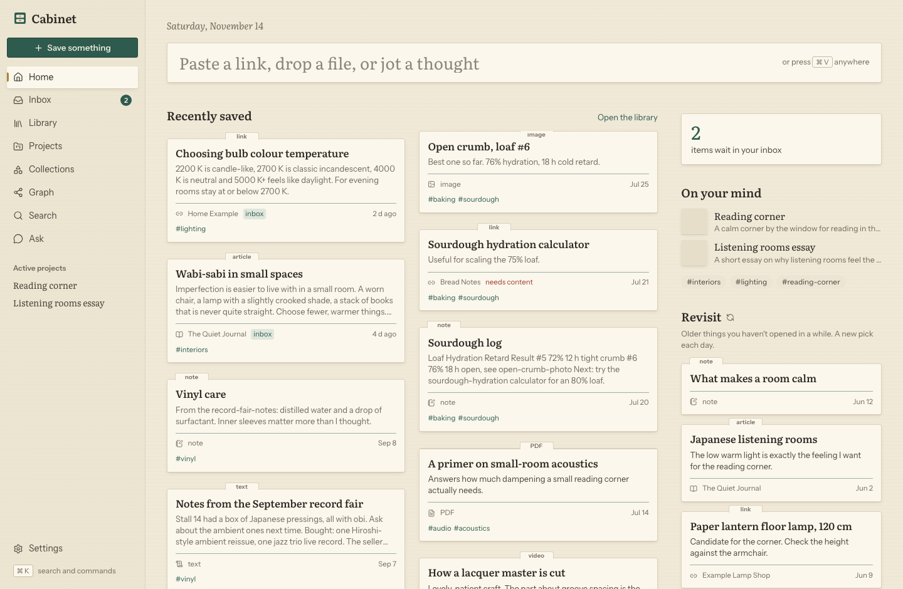

# Cabinet

A local-first home for saved articles, images, PDFs, notes and hobby projects, with linked Markdown and memory for AI agents.

**The app and your library are separate.** Clone this repository for the software; your own content lives in `~/Cabinet` by default, or any folder you choose. A new library starts empty. The included `sample-library/` and screenshots contain synthetic demo content.



## Start locally

Install **Node.js 26**, **pnpm 10.32.1** and **Git**, then:

```sh
git clone https://github.com/latrael/cabinet.git
cd cabinet
pnpm install --frozen-lockfile
pnpm build
pnpm cabinet init "$HOME/Cabinet"
pnpm start
```

Open **http://localhost:4747**. The repository is currently private; cloning requires access. Node 24.12+ is supported by the package requirement; this release was tested with Node 26.

For another library location:

```sh
pnpm cabinet path "/absolute/path/to/My Cabinet"
pnpm cabinet init
pnpm start
```

To try the demo separately, initialize a new folder with `--sample` and pass it explicitly when starting:

```sh
pnpm cabinet init "$HOME/Cabinet-Demo" --sample
pnpm cabinet start --library "$HOME/Cabinet-Demo" --no-ai --no-telegram
```

## What it does

- Capture links, quotes, text, images, PDFs and audio; add why you saved them and connect them to existing items.
- Write notes with `[[links]]`, backlinks and a focused graph.
- Organize projects using material sections, per-project context, questions and checklists.
- Search locally by keywords; add Ollama for meaning search, cited chat and suggested enrichment.
- Let agents use your library through MCP, with per-agent tokens for HTTP access.
- Capture from Telegram, including locally transcribed voice notes.
- Keep ordinary Markdown and attachments with local git history, external-edit watching and export/restore.

Core capture, reading, editing and keyword search work without AI. Fetching new URLs and Telegram require internet access. Ollama is the default AI provider; optional Anthropic/OpenAI providers use your own API keys. Voice transcription needs ffmpeg, whisper.cpp and a model.

## Guides

| Guide | Covers |
| --- | --- |
| [Setup](docs/SETUP.md) | Native installation, Docker, macOS launchd, models, configuration, backups and updates |
| [Storage](docs/STORAGE.md) | Files, frontmatter, links, projects, git and generated/private state |
| [Agents and MCP](docs/AGENTS-MCP.md) | Claude Code/Desktop, stdio, HTTP and tool reference |
| [Telegram](docs/TELEGRAM.md) | Bot pairing, capture and local voice transcription |
| [Limitations](docs/LIMITATIONS.md) | Current boundaries and exactly what was verified |
| [Screenshots](docs/screenshots/README.md) | Capture, reader, editor, projects, graph, search and Settings |
| [Build plan](PLAN.md) | Milestones and completion record |

## Docker

The image includes the built web app, Node, Git, ffmpeg and whisper.cpp. Your library and speech model are host-mounted; neither is baked into the image.

Follow the [Docker setup guide](docs/SETUP.md#docker) to set the initial passphrase and mount a parent data folder that supports restore backups. Compose publishes port 4747 on host localhost by default.

## Development and checks

```sh
pnpm test
pnpm lint
pnpm typecheck
pnpm build
pnpm exec playwright install chromium
pnpm e2e
```

Browser tests use temporary copies of the demo library. For development, set `CABINET_LIBRARY` to a separate demo folder before running `pnpm dev`; Vite runs on port 5173 and proxies API requests to the server on 4747. `pnpm dev` otherwise opens your configured/default library.

Milestones 0–10 are implemented. See [Limitations](docs/LIMITATIONS.md) for verification boundaries. MIT licensed; see [LICENSE](LICENSE).
