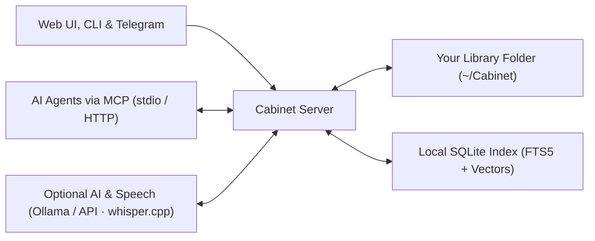
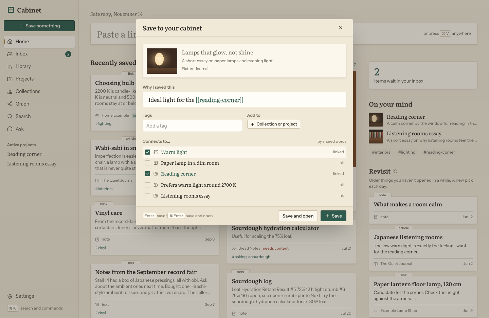
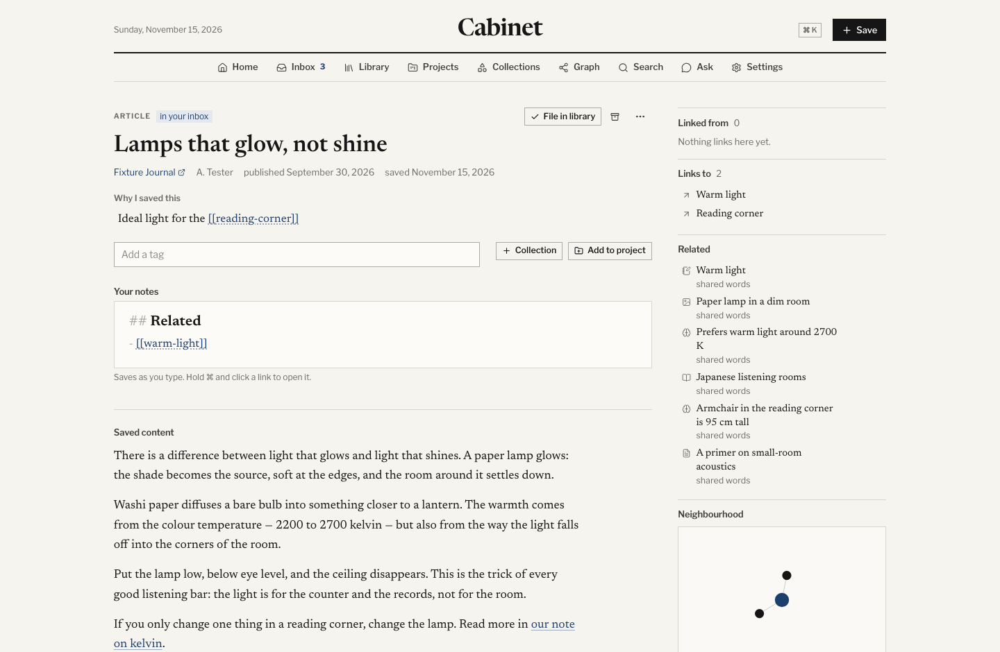
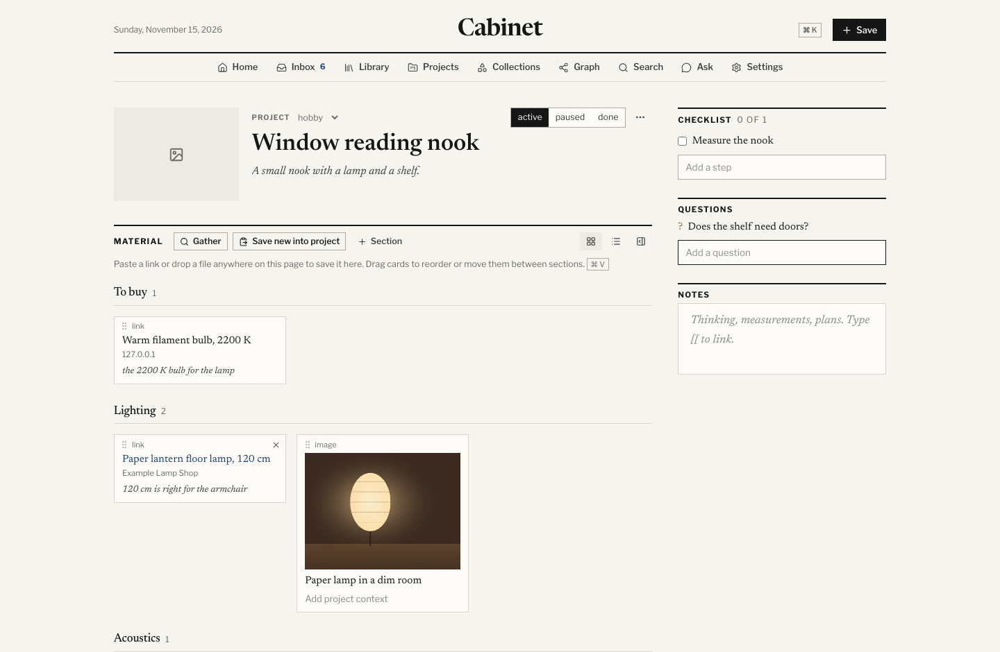
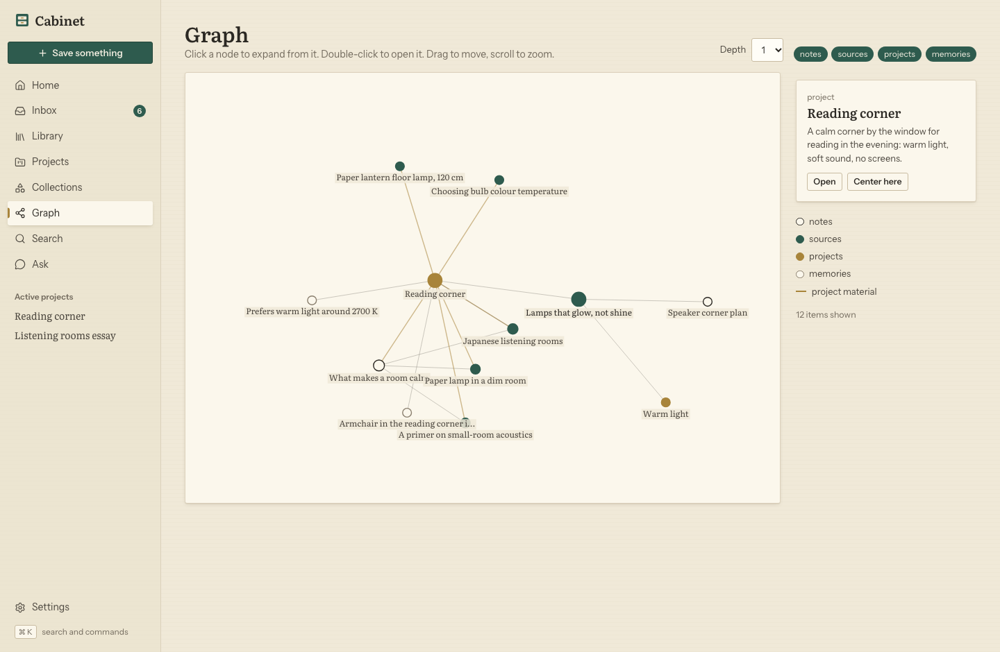
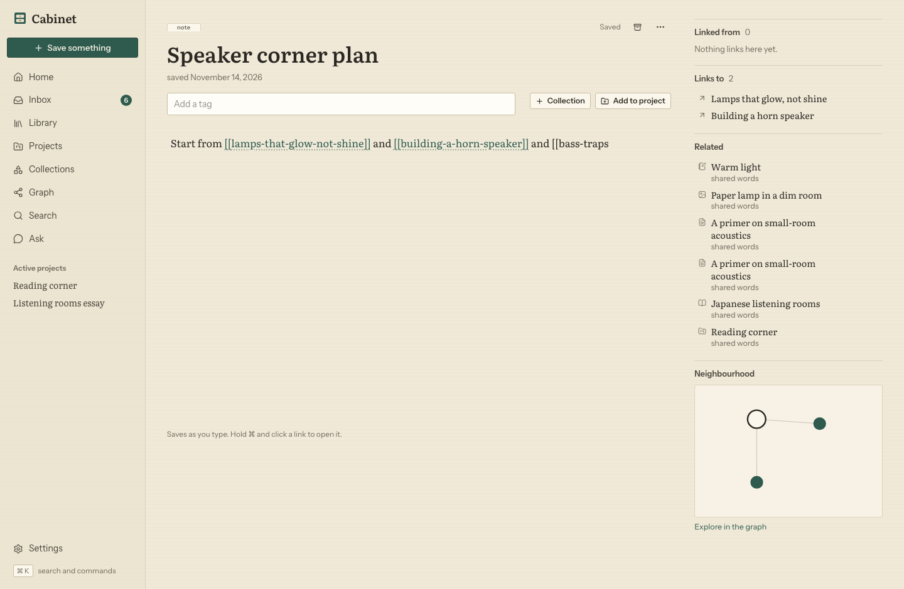
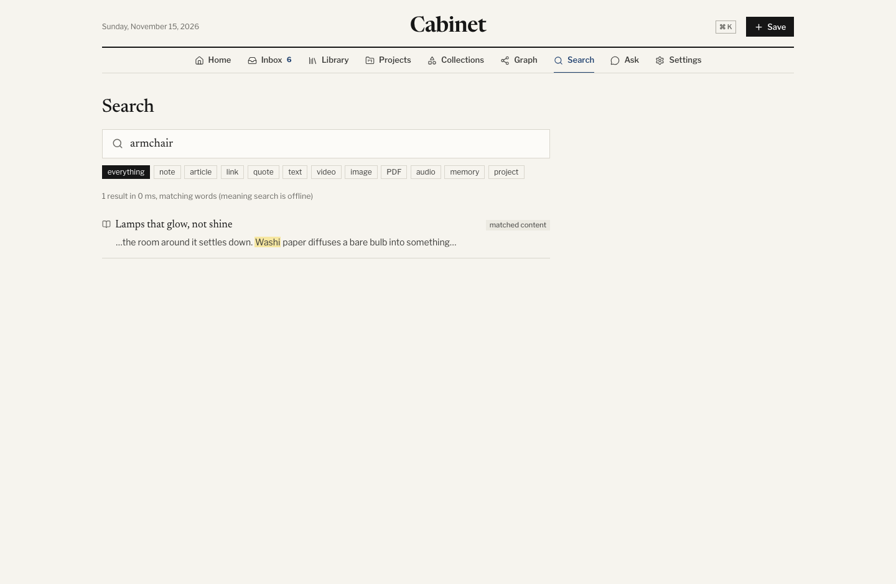

# Cabinet

**A local-first home for saved links, media, notes, and hobby projects — stored as plain Markdown and shared directly with AI agents.**

[](LICENSE)
[](https://nodejs.org/)
[](docs/AGENTS-MCP.md)

[What it is](#what-is-cabinet) · [Why](#why-cabinet) · [How it works](#how-it-works) · [User flow](#user-flow) · [Screenshots](#screenshots) · [Quick start](#quick-start) · [Technical details](#technical-details)


---

## What is Cabinet?

Cabinet is a personal research hub, project workbench, and memory layer for AI agents that runs locally on your machine.

Instead of scattering articles in browser tabs, quotes in chat logs, PDFs in folders, and project checklists in separate tools, Cabinet brings them together in one place — backed entirely by ordinary Markdown files and attachments on your disk. Your reading, your writing, and the context your AI agents need all live in the same library.

## Why Cabinet?

Most personal knowledge tools break down along the same three seams:

- **Bookmark and read-it-later tools hide *why* you cared.** Saving a link without context turns into a graveyard of unread URLs, locked inside someone else's database. Cabinet asks why you saved something up front and keeps the extracted text, attachment, and your notes together as plain files.
- **General note-taking tools struggle with rich capture and active projects.** Writing notes is easy; pulling in clean article extracts, PDF text, timestamped videos, images, and transcribed voice notes — then organizing them around an ongoing hobby or build with open questions and checklists — usually takes fragile plugins or manual copy-pasting.
- **AI assistants start every session with amnesia.** Your research sits in one place while your coding and chat agents live in another. Cabinet exposes your library over [MCP](docs/AGENTS-MCP.md) so agents can pull project context, search past captures, and commit atomic memories back to your files with clear attribution.

## How it works

Cabinet intentionally separates **the application** from **your library**:



1. **Your library is just a folder** (`~/Cabinet` by default, outside this repository). Everything you save is stored as human-readable Markdown with YAML frontmatter, `[[wikilinks]]`, and original attachments, versioned automatically in a local Git repository.
2. **Cabinet runs locally on top of your files.** A single Node process serves the web UI, watches for external edits from any text editor, and maintains a disposable SQLite index (`.cabinet/index.sqlite`) that can be deleted and rebuilt from your Markdown files at any time.
3. **Optional layers plug in when you want them.** Core capture, reading, editing, `[[linking]]`, and keyword search work offline with zero AI setup. Add **Ollama** (or your own Anthropic/OpenAI key) for semantic search, library chat, and suggested enrichment; connect **MCP** for AI agents; or pair a **Telegram bot** with local `whisper.cpp` for mobile and voice capture.

## User flow

1. **Capture anything with context** — Paste a URL, drop an image or PDF, jot a quote, or send a voice note from Telegram. Record *why* you saved it and connect it to existing items while articles/PDFs/audio are extracted in the background.
2. **Think in linked Markdown** — Read clean extracted content side-by-side with your own notes, link ideas with `[[wikilinks]]`, inspect backlinks, and explore connections in a focused neighborhood graph.
3. **Organize living projects** — Group relevant sources into project sections with per-project context, track open questions, and work through checklists without duplicating underlying files.
4. **Recall and collaborate with agents** — Find anything via keyword or meaning search with match explanations, ask cited questions against your library, or let MCP agents read briefings (`get_context`) and save durable `memories/` as tracked Git commits.

## Screenshots

All screenshots below use the included synthetic demo library (`sample-library/`). See the [full screenshot walkthrough](docs/screenshots/README.md) for every screen.

| | |
| --- | --- |
| <br>**Capture** a link, record why you saved it, and link it to existing items. | <br>**Read** extracted articles alongside your notes and connections. |
| <br>**Projects** organize material into sections with checklists and open questions. | <br>**Graph** visualizes local neighborhoods around any item or project. |
| <br>**Notes** use plain Markdown with `[[links]]` and live backlinks. | <br>**Search** explains exactly where and why each result matched. |

## Quick start

### Prerequisites

- **Node.js 24.12+** (tested with **Node 26**)
- **pnpm 10.32.1** (`npm install -g pnpm@10.32.1`)
- **Git**

### Run locally

```sh
git clone https://github.com/latrael/cabinet.git
cd cabinet
pnpm install --frozen-lockfile
pnpm build
pnpm cabinet init "$HOME/Cabinet"
pnpm start
```

Open **[http://localhost:4747](http://localhost:4747)**. Your library starts empty at `~/Cabinet` and stays completely separate from the cloned app repository.

<details>
<summary>Try it with the sample library (without touching your own folder)</summary>

```sh
pnpm cabinet init "$HOME/Cabinet-Demo" --sample
pnpm cabinet start --library "$HOME/Cabinet-Demo" --no-ai --no-telegram
```

</details>

<details>
<summary>Use a custom library path</summary>

```sh
pnpm cabinet path "/absolute/path/to/My Cabinet"
pnpm cabinet init
pnpm start
```

</details>

<details>
<summary>Run with Docker</summary>

The container image includes the built web app, Node, Git, `ffmpeg`, and `whisper.cpp`. Your library and optional speech models are host-mounted so nothing personal is baked into the image.

Follow the [Docker setup guide](docs/SETUP.md#docker) to configure `.env`, initialize your library, set an access passphrase, and start via `docker compose`.

</details>

## Technical details

### Guides & documentation

| Guide | Covers |
| --- | --- |
| [Setup](docs/SETUP.md) | Native install, Docker, macOS `launchd`, Ollama/AI keys, network access, backups, and restore |
| [Storage format](docs/STORAGE.md) | Folder layout, YAML frontmatter schema, `[[links]]`, project syntax, Git history, and `.cabinet/` internals |
| [Agents & MCP](docs/AGENTS-MCP.md) | Local `stdio` and authenticated HTTP `/mcp` setup, agent Git attribution, and full MCP tool reference |
| [Telegram & voice](docs/TELEGRAM.md) | Long-polling bot pairing, mobile capture, and local `whisper.cpp` transcription |
| [Limitations](docs/LIMITATIONS.md) | Current scope, security model, backup caveats, and verification boundaries |
| [Screenshots](docs/screenshots/README.md) | Complete visual tour of capture, reader, editor, projects, graph, search, Settings, and Telegram |

### Repository layout

```text
cabinet/
  apps/
    web/            React + Vite + Tailwind web client (CodeMirror 6 editor, d3-force graph)
    server/         Hono HTTP API, SSE live updates, capture pipeline, auth, Telegram bot
    cli/            `cabinet` CLI (`init`, `start`, `mcp`, `path`, `token`, `rebuild`, `export`, `restore`)
  packages/
    core/           Markdown/frontmatter parser, link resolver, node:sqlite FTS5 index, watcher, git
    ai/             Provider abstraction (Ollama / Anthropic / OpenAI), embeddings, chat, whisper
    mcp/            MCP server tools & resources (`stdio` and Streamable HTTP)
  sample-library/   Synthetic demo library
  docs/             Setup, storage, MCP, Telegram, and verification docs
  e2e/              Playwright browser tests
```

### Development & checks

For local development, set `CABINET_LIBRARY` to a separate test folder before starting Vite (`:5173`, proxying API requests to `:4747`):

```sh
CABINET_LIBRARY="$HOME/Cabinet-Demo" pnpm dev
```

Run the full check suite:

```sh
pnpm test
pnpm lint
pnpm typecheck
pnpm build
pnpm exec playwright install chromium
pnpm e2e
```

### License

[MIT](LICENSE)
