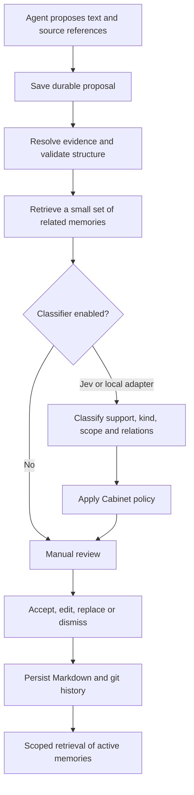

# Structured agent memory with an optional Jev classifier

Status: proposed design, 2026-11-15. No implementation, provider calls, migrations or automatic memory writes are authorized by this document.

## Product outcome

An agent can propose a useful memory without inventing its authority. Cabinet records what was asserted, where it applies, what supports it, who proposed/accepted it and whether it still applies. The owner can review, correct or replace it. Later agents receive relevant, current statements with their provenance and uncertainty intact.

Jev is a candidate classifier behind this flow. Cabinet owns the schema and actions; the integration must remain useful without Jev or network access.

## Current behavior and gaps

`packages/mcp/src/server.ts` exposes `remember(fact, title?, tags?)`. It immediately creates a `type: memory` Markdown item, attributing the writer to the authenticated MCP agent. Its instruction to recall first is advisory: there is no enforced duplicate/evidence/lifecycle check. `recall` searches memory items; `get_context` inserts matching bodies under “What I know”.

The sample armchair memory combines a measurement (“95 cm tall”) with a lamp requirement (“at least 120 cm”). The current format does not distinguish a user measurement from an agent recommendation. The sample project repeats that statement; repetition alone is not independent evidence of its origin.

`state.sqlite` holds disposable app state, not reconstructable memory provenance. Durable memory proposals and their approval state should therefore live in library files, not only in that database.

## Why Jev, and its boundary

TypeSafe documents Jev's Choice, Score and Noul questions: fixed options, rubric levels and yes/no probabilities. It does not generate the prose needed to rewrite a memory or split a compound statement. Use a proposing agent, optional existing Ollama model or the owner for that work. See [Choice](https://docs.typesafe.ai/primitives/choice) and [the vendor's memory cookbook](https://docs.typesafe.ai/cookbooks/basic_memory).

Jev should answer narrow questions about a candidate and supplied evidence. It cannot verify the physical chair, recover an omitted conversation, authenticate a user statement or decide which files it is permitted to change. A structured answer can still be semantically wrong.

The memory cookbook demonstrates selecting useful past information and reinserting it into later requests. Cabinet additionally needs atomic claims, persistent evidence, explicit scope, review, expiry and conflict handling. Its example threshold is not a validated threshold for Cabinet.

## Example owner experience

An agent proposes: “The reading-corner armchair is 95 cm tall; choose a lamp at least 120 cm tall.”

1. Cabinet saves a proposal, with its supplied source reference and original wording.
2. A compound-claim check asks for two proposals. The proposing agent or owner splits the text; Jev does not rewrite it.
3. The review screen shows the measurement as a proposed fact scoped to that particular chair. It shows the lamp statement as a recommendation/inference unless evidence records an actual user decision.
4. The owner sees the supporting passage and can accept, edit or dismiss each independently. Acceptance is not presented as independent physical verification.
5. If the owner later reports buying another chair, Cabinet asks whether this is a different object. A new chair does not silently overwrite the old chair's historical measurement.
6. If a measurement for the same chair is corrected, the review shows the old and new values. The owner can replace the old memory while retaining its history.

## Responsibilities

| Component | Owns |
| --- | --- |
| Proposing agent / optional extraction model | Candidate wording, proposed splits and suggested source references |
| Cabinet code | Authentication attribution, source resolution, hashes, allowed fields, deterministic checks, retrieval, lifecycle transitions, writes and audit |
| Jev adapter | Classification and evidence/relation judgments, with the returned probabilities and model identity |
| Owner | Acceptance/correction, confirming a statement as theirs and resolving uncertain replacements |

Do not let model output set `approved_by`, fabricate evidence references, assert an authenticated speaker or write files directly.

## Durable memory format

Keep `type: memory`, the existing item ID/title/timestamps, `agent` and `captured_via`. Add a versioned nested `memory` object. Use the existing item `status` for inbox/library/archive; use a separate memory lifecycle, because these concepts have different meanings.

Illustrative future frontmatter, with placeholder IDs:

```yaml
type: memory
status: inbox
agent: claude
captured_via: mcp:claude
memory:
  schema_version: 1
  kind: fact
  scope:
    kind: item
    refs: [CHAIR_ITEM_ID]
    project_refs: [READING_CORNER_PROJECT_ID]
  basis: reported_by_agent
  lifecycle: proposed
  evidence:
    - item_id: SOURCE_ITEM_ID
      section: Measurements
      source_hash: SOURCE_REVISION_HASH
      quote: The armchair is 95 cm tall.
  observed_at: 2026-11-12T09:30:00Z
```

The body remains readable: “The armchair in [[reading-corner]] is 95 cm tall.” Keep the source quote if the source later changes, and flag changed/missing support. A proposed speaker attribution supplied by an external agent remains agent-reported until Cabinet can resolve a trusted source or the owner confirms it.

Field contract:

| Field | Values / rule |
| --- | --- |
| `kind` | `fact`, `preference`, `decision`, `inference`; unsuitable material can remain a note instead |
| `scope` | `owner`, `project`, `item`, `unknown`; references use stable IDs. Unknown scope requires review |
| `basis` | `user_statement`, `source_supported`, `agent_inference`, `reported_by_agent`, `unknown`; identifies support, not universal truth |
| `lifecycle` | `proposed`, `active`, `superseded`, `expired`, `rejected` |
| `evidence[]` | Resolved source ID, source revision hash, section/anchor where available and a bounded supporting quote |
| `observed_at` | When the statement/observation was made, if known; separate from file creation time |
| `valid_from`, `valid_until` | Optional explicit applicability bounds; do not expire everything on an arbitrary schedule |
| `supersedes` / `superseded_by` | Stable memory IDs; written only through an accepted replacement operation |
| `approval` | Server-recorded actor, time and accepted proposal revision; unavailable as classifier-controlled fields |
| `analysis` | Classifier/model identity, policy/schema version, analyzed content/evidence hashes, outcome and relevant scores; separate from factual basis |

Acceptance can change the scope/basis through an explicit owner action. Selecting “Accept as reported” must not mean “I personally measured this”. Offer “Confirm this statement as mine” as a distinct action.

Classifier certainty belongs to `analysis`; it is not a new factual `confidence: 0.99` badge attached to the chair's height.

## Proposal pipeline



1. **Preserve the proposal first.** Capture the original wording, authenticated proposer and available evidence. Model outages must not lose a submitted memory.
2. **Validate in code.** Check IDs, permitted paths, evidence existence/quote agreement, schema and request idempotency. A matching quote proves the passage exists, not that it entails the claim.
3. **Retrieve likely duplicates/conflicts.** Reuse keyword/vector search with scope filtering. Start with a small bounded shortlist (for example, up to eight candidates); evaluate this cap before raising it. Do not compare against the whole library on every write.
4. **Classify.** Send candidate text, a minimal source excerpt, application-resolved scope candidates and relevant existing statements. Never send the whole library by default.
5. **Apply policy in code.** Scores can route review priority. They cannot accept/reject files or resolve contradictions on their own.
6. **Review and persist.** Recheck source/proposal/related-memory revisions at acceptance. Editing the candidate invalidates its prior analysis. Replacement must be idempotent, preserve history and recover safely after interruption.

A source change triggers a support recheck. If the quoted passage is unchanged, a changed whole-file hash alone should not invalidate the claim. If support disappears or changes materially, flag the memory for review and omit it from default authoritative context until resolved.

Pending proposals are Markdown items (`status: inbox`, `memory.lifecycle: proposed`) so rebuild/export retains them. Analysis/retry work can use a queue/cache, but pending proposals must be discoverable after restart and safely retried using content/model/policy hashes.

## Questions Jev would answer

These are a proposed decision contract, not claimed measured Jev performance or a ready-to-send SDK payload.

| Question | Candidate output |
| --- | --- |
| Is this one independently maintainable claim? | Noul: atomic claim vs multiple claims |
| What kind of memory is proposed? | Choice: fact / preference / decision / inference / unsuitable / unclear |
| Does the passage support the claim without adding an assumption? | Choice: supports / contradicts / insufficient / unclear |
| Does it describe established or hypothetical information? | Choice: asserted / hypothetical / negated / unclear |
| Where does it apply, given these resolved entities? | Choice: owner / selected project or item / unknown |
| Is this useful beyond the current exchange? | Choice: durable / temporary / unclear; an explicit short-lived decision can still be useful |
| How does it relate to each shortlisted memory? | Choice: same claim / correction / possible conflict / different entity or time / unrelated / unclear |

Questions must each include enough state to stand alone. A response to one question is not evidence supplied to another question in that same request. Avoid a forced label when none fits; retain an uncertain/manual path.

Use contextual examples in the policy: “I like warm light in this room” is not a preference for every room; “maybe buy a 120 cm lamp” is not a purchase decision; “the old chair was 95 cm” does not describe its replacement.

## Acceptance policy

**First release: every new agent memory is a proposal. No automatic activation.** The classifier explains/routes proposals while the owner establishes useful defaults.

- Explicit, scoped, supported statement: ready for ordinary review.
- Missing/unresolvable source: show “agent-reported” or “needs evidence”; never manufacture a citation.
- Unsupported inference: offer to keep it as an inference/note, not accept it as an established fact.
- Compound statement: return a split request with the original proposal preserved.
- Exact duplicate: return the existing memory, preserving a new evidence reference as a reviewable addition when useful.
- Semantic duplicate or correction: show the comparison; do not silently merge or overwrite.
- Conflicting measurement/preference: require entity/time/context resolution before replacement. A newer timestamp alone is not authority.
- API timeout, rate limit, disabled classifier or ambiguous response: leave the proposal available for manual review.

Later automation is a separate opt-in step after evaluation. Start only with narrowly scoped, explicitly sourced user statements. Classifier certainty cannot turn an inference into a user-confirmed fact.

TypeSafe distinguishes its Choice/Score `confidence` statistic from an option's probability, and Noul answers do not carry that same confidence field. Keep these values distinct and choose per-decision thresholds from Cabinet-specific evaluation. Do not copy a universal threshold from a demo. [Confidence documentation](https://docs.typesafe.ai/confidence).

## API, retrieval and UI changes

**MCP/API:** keep `remember` discoverable, but make its behavior explicitly “propose a memory”. Add evidence/scope inputs and return an unambiguous outcome such as `proposed`, `already_known` or `needs_evidence`, plus IDs and review status. Do not keep returning `remembered: true` for inactive proposals. Update tool instructions/tests/docs together; decide versioning for existing clients before shipping.

**Shared service:** centralize proposal/acceptance rules in `packages/core` with a classifier adapter in `packages/ai`. Use it from MCP, the server and optional chat tools. Generic memory create/update routes must not bypass the rules. Validate externally edited files on indexing and flag malformed or changed approval metadata for review. An agent with unrestricted filesystem access has the owner's filesystem privileges; plain Markdown/Git attribution is not a cryptographic proof of who approved a statement. Strong isolation from such an agent would require a separate access boundary and is outside this first release.

**Retrieval:** `recall` and `get_context` should default to valid active memories with applicable scope and dates. Apply filters before final top-K selection in both keyword/vector paths so rejected/proposed items cannot crowd out valid results. Include evidence references and distinguish recorded facts, user preferences/decisions and agent inferences in returned context. Let callers explicitly request proposals/history for review.

**Review screen:** list proposed memories with editable text, kind/scope, a supporting passage and any related/conflicting memory side by side. Provide Accept as reported, Confirm as mine, Edit/split, Replace existing and Dismiss. Show plain labels such as “Agent-reported”, “Supported by this passage”, “Scope unclear” and “Possible duplicate”. Keep raw model scores in an expandable diagnostic panel.

**Settings:** classifier off/manual by default; optional local adapter or Jev; model selection, masked key, connection status, usage and a clear description of which excerpts are sent remotely. This is separate from the chat/embedding provider selection.

**Old memories:** label missing-schema records as legacy/unreviewed. Keep them visible and explicitly retrievable, but do not silently label them verified or mix them into default authoritative context. Provide a migration preview and bulk review; preserve original IDs and git history. Migrate synthetic fixtures deliberately, not the owner's real library without review.

## Local-first operation and hosted data

Jev's documented TypeSafe endpoint is a hosted service. Make it optional and explicitly enabled per library. Keep the key in the existing ignored secrets mechanism; send only the candidate and necessary evidence/comparison excerpts. Exclude credentials and avoid logging raw payloads. A local structured-output model can implement the same interface, but do not invent calibrated probabilities for a provider that does not return them.

The vendor says customer inputs/outputs are not used for training, standard retention has no published fixed period, and organizations can enable zero data retention. Confirm the selected account/provider's settings before real-library evaluation. [TypeSafe data-use and retention policy](https://help.typesafe.ai/articles/5974925716).

Manual proposal/review/retrieval must work offline. A Jev outage must not change a claim's basis, activate a proposal or prevent ordinary note-taking. This plan does not provision an account, enable a hosted service or send personal content to one.

## Evaluation before automation

Build a small owner-labelled fixture set first, approximately 100–150 candidates as a starting effort budget, including:

- Explicit facts/preferences/decisions and agent inferences.
- Compound claims and missing/forged/misleading citations.
- Hypotheticals, negation and assistant suggestions repeated as facts.
- Same topic with different objects, projects or dates.
- Unit changes, numeric corrections and genuine contradictions.
- Real duplicates versus complementary claims.
- Updated/deleted sources and instruction-like text inside evidence.
- Temporary context and stale imported memories.

Compare Jev with the existing local model and a manual/rules baseline. Separate development examples from held-out cases. Record the resolved model version, exact policy/schema, per-label precision/recall, unsupported-fact promotions, scope mistakes, false merges, review rate, latency, token usage and observed cost. High overall accuracy alone does not justify unattended writes.

The first pass can use fixtures and recorded responses with no hosted calls. Live comparison requires a configured provider/account and an explicitly bounded run. Pin the evaluated model/policy and re-evaluate on upgrades. Do not claim independent confirmation merely because a second model agrees with the proposing model.

## Implementation milestones and stop points

| Step | Deliverable | Evidence needed before stopping |
| --- | --- | --- |
| 1. Contract and durable proposals | Versioned schema, proposal lifecycle, evidence resolver, shared service, MCP outcome update; no Jev dependency | Tests for idempotency, source attribution, invalid references, compound proposals retained for splitting and duplicate submissions; existing content remains readable |
| 2. Review and retrieval | Proposal UI, manual acceptance/correction/replacement, scoped active-memory retrieval and legacy migration preview | Chair example end to end; proposed/rejected/expired memories excluded by default; stale edits and replacement conflicts handled; export/rebuild preserves review state |
| 3. Jev in review mode | Optional adapter/settings, bounded inputs, stored analysis metadata, retry/cache behavior | Mocked contract/outage tests plus a labelled evaluation report; a bounded live fixture run only when separately configured/authorized |
| 4. Optional automation | A narrowly defined auto-accept policy and owner controls | Measured held-out precision and error review justify each enabled action; uncertainty/inference/conflict cases still require review |

Stop after each step for review. Do not bundle automatic background mining of every note into the first implementation. A later “Suggest memories from this note” action can use the same pipeline once proposal quality is understood.

Recommended first build: steps 1–2, then evaluate Jev in step 3. This makes useful memory structure independent of a particular model, and gives the classifier concrete decisions and owner-labelled examples to improve.
